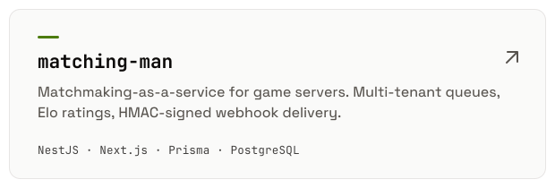
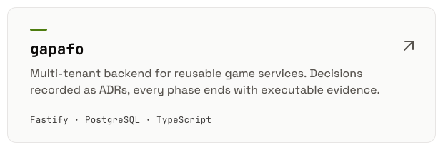
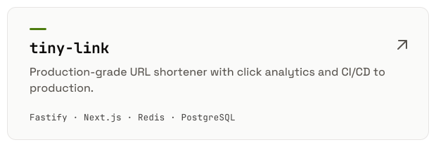
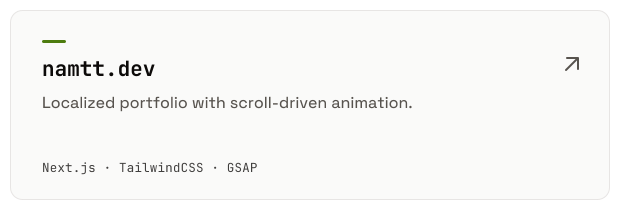
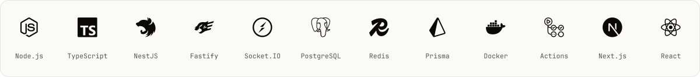

<picture>
  <source media="(prefers-color-scheme: dark)" srcset="assets/banner-dark.svg">
  
</picture>

  <a href="https://namtt.dev">Website</a> &nbsp;·&nbsp;
  <a href="https://www.linkedin.com/in/thanhnam2811">LinkedIn</a> &nbsp;·&nbsp;
  <a href="https://namtt.dev/files/MyCV.pdf">Résumé</a>

## Selected work

  <a href="https://github.com/thanhnam2811/matching-man"><picture>
    <source media="(prefers-color-scheme: dark)" srcset="assets/card-matching-man-dark.svg">
    
  </picture></a>
  <a href="https://github.com/thanhnam2811/gapafo"><picture>
    <source media="(prefers-color-scheme: dark)" srcset="assets/card-gapafo-dark.svg">
    
  </picture></a>
  <a href="https://github.com/thanhnam2811/tiny-link"><picture>
    <source media="(prefers-color-scheme: dark)" srcset="assets/card-tiny-link-dark.svg">
    
  </picture></a>
  <a href="https://github.com/thanhnam2811/my-portfolio"><picture>
    <source media="(prefers-color-scheme: dark)" srcset="assets/card-namtt-dev-dark.svg">
    
  </picture></a>

## Stack

<picture>
  <source media="(prefers-color-scheme: dark)" srcset="assets/stack-dark.svg">
  
</picture>

Open to full-time and freelance work — LinkedIn is the best way to reach me.

